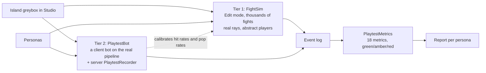

# AI Playtest (boss arena)

Companion to [[design/boss-arena]], [[systems/Boss]] and [[systems/Tests]].

## Why

The user (2026-11-17): a human playtest for "is it fun" is slow and costly. Before
one, run an AI-driven playtest against metrics that stand for fun, and polish the
level until a human playtest is as useful as it can be. The user is open to new
mechanics where the data calls for them: boss moves, phases, and minions destroyed
by the letter-gathering mechanic.

## The team (roles played by agents, 2026-11-17)

| Role | Who | Output |
|---|---|---|
| Product owner | the parent session | scope, architecture, this page, the decisions list for the user |
| Senior game designer | Opus subagent, read-only | pillars, metric matrix, personas, predictions, candidate fixes (below) |
| Simulation engineer | the parent session | `src/shared/Playtest/` (built) |
| Bot and recorder engineers | Sonnet subagents, not yet started | `src/client/Playtest/`, `src/server/Playtest/` |
| Balance analyst | the parent session, after the first numbers | findings and a tuning proposal |

## Architecture

Two sources, **one event schema, one metrics module**, so a simulated fight and a
real one are scored the same way.



- **Tier 1, the simulator** (`src/shared/Playtest/Sim/`). Runs in Studio's Edit
  DataModel through `execute_luau`; no playtest needed. It reads the real config
  (`BossConfig`, `SpellRegistry`, `EnergyEconomy`, `LetterTables`, `WordKits`, the
  dictionary) and scans the arena out of the DataModel (`SimLevel`). Players and the
  boss are abstract agents, but **line of sight and every boss fireball are real
  raycasts against the greybox**. It takes tuning overrides and models mechanics that
  are not built yet, so a fix can be judged before anyone builds it.
- **Tier 2, the real bot.** A client `LocalScript` gated by a workspace attribute and
  `RunService:IsStudio()`, playing through the production path: the real
  `PlayerSession`, `EconomyReport.memorize`, the `RequestCast` bindable, the
  `ConsumeBlock` remote, the lobby portal and the entry pad. A server recorder listens
  to the domain BindableEvents (`BlockConsumed`, `WordMemorized`, `MemorizeFizzled`,
  `SpellCast`, `PlayerDamaged`, `BossDefeated`, round events, wall state) and
  publishes the event log. It exists to check the simulator's assumptions (hit rate by
  distance and movement, pop rate, travel time) and to catch what a model cannot:
  pathing, real walls, real VFX timing.
- Edit mode caches `require` results across `execute_luau` calls
  ([[reference/studio-mcp]]), so the runner snippet clones the `Playtest` folder and
  requires the clone.

## Facts found while scoping (code read 2026-11-17, none yet measured)

- **Boss max health does not affect time to kill.** Player damage is a fraction of the
  target's max HP: Firebolt 5%, Fireball 20%, Inferno 50%. Two Infernos (40 red mana)
  kill; Stasis (2x amp) plus one Inferno may kill from full.
- **The volley does not lead its target.** Each shot aims at where the player is when
  it launches and flies straight at 90 studs a second. A player walking sideways at 16
  is more than 3 studs away on arrival from about 17 studs out, so a moving player may
  never be hit. The 14 s death on 2026-11-17 was a standing character.
- **The boss never closes.** It stops at `attackRange` (100) and Ground Slam is only
  offered inside 18 studs, so a slam happens only if the player walks in. The premium
  letters float 18 studs up at the boss spot and can be popped from the rim.
- **Spells out-range the boss**: auto-target 150, pop reach 200, boss attack 100.
- **A frozen boss probably still attacks.** Freeze pins `WalkSpeed` and pauses hunger;
  the state machine still ticks. To verify in Tier 2.
- The review island is live as a PvEBoss arena: 16 zones (58 letters), 25 walls.

## Fun pillars (designer)

| # | Pillar | Failed if |
|---|---|---|
| P1 | A spell within 20 seconds, even for a 7-year-old on a phone | novice first cast over 35 s, or first rewarding cast over 90 s |
| P2 | The Brain is always a threat and the threat fades with distance | any spot damages the boss while taking nothing for 20 s; or a moving novice dies in under 25 s in the open |
| P3 | Big words are big moments, small words still count | over 70% of damage from one tier, or a 3-4 letter word buys no cast |
| P4 | Everyone can win; better spellers win faster and safer | novice win rate under 60%; strong kills less than 2x or more than 3.5x as fast as novice |
| P5 | Always something to do | 15 s with no pop, memorize, cast, hit taken or boss damage |
| P6 | Risk pays, and dying does not end the run | an excursion earns under 1.5x baseline energy a second; win rate after a first death under 40% |

## Metric matrix (designer)

`t0` is the boss landing. Alive time excludes respawn transit. Effective damage is
boss HP actually lost. Bands are for the Average persona unless one is named.

| # | Metric | Definition | Green / amber / red | Levers |
|---|---|---|---|---|
| M1 | Time to first cast | first cast − t0 | ≤20 / 20–35 / >35 s (Novice ≤30 / 30–45 / >45) | `TIER_COSTS[1]`, letter density |
| M2 | Time to first rewarding cast | first cast doing ≥15% boss damage, or a heal/shield worth ≥30 HP, or a freeze landing in a windup | ≤60 / 60–90 / >90 s (Novice ≤90 / 90–120 / >120) | damage fractions |
| M3 | Mana income | memorized energy per alive minute | Average 35–55 / 25–35 or 55–80 / other; Novice ≥15 | letter values, tables, `BLOCK_RESPAWN_DELAY` |
| M4 | Time to kill | boss death − t0 | Strong 80–130, Average 150–220, Novice 220–290 s; red if anyone under 60 or Average over 270 | spell fractions, amp, `eatHealFraction` |
| M5 | Pacing ratio | time to 50% ÷ TTK | 0.40–0.60 / 0.30–0.40 or 0.60–0.70 / other | Inferno fraction, a phase 2 |
| M6 | Win rate | wins ÷ fights | Novice ≥60 / 40–60 / <40%; Average ≥85; Strong ≥98; Rusher 30–70; Turtle no better than Average and slower | everything |
| M7 | Deaths per fight | count | Average 0.5–1.5; Novice 1–2.5; red at 0 for everyone or over 3 | spread, volley count, cooldown, cover HP |
| M8 | Tension | share of alive time at HP ≤30 | 8–20 / 3–8 or 20–30 / other % | volley damage, heal values |
| M9 | Hit rhythm | median gap between damage bursts; longest no-damage stretch within 150 studs | median 6–12 s and longest ≤25 s / 12–20 or ≤40 / other | cooldown, more attacks |
| M10 | Dead time | longest window with no pop, memorize, cast, damage either way or tow steal | ≤8 / 8–15 / >15 s; transit ≤12 s | entrance delay, respawn path |
| M11 | Spell variety | share of casts per colour; green mana wasted | each colour ≥15% and waste ≤40% / 8–15% / green <8% or waste >60% | green/blue spell values |
| M12 | Tier mix | share of damage per tier | none over 60% / 60–75% / over 75% | damage curve |
| M13 | Burst cap | most boss damage in any 5 s | ≤35 / 35–50 / ≥50% | amp, Inferno, phase gate |
| M14 | Risk-reward uptake | per feature (premium, gates, cave, fossils): share of fights used, energy/s against baseline, deaths on excursion | uptake ≥40%, payoff 1.5–3x, deaths 10–30%; red at uptake <10% or payoff <1x | premium reach, gate health, fossil lifetime |
| M15 | Hunger heal share | HP healed by eating ÷ damage dealt; tows stolen ÷ started | 5–12 / 12–20 / >20%; steal rate 30–60% | the four `eat*` values |
| M16 | Safe-spot exploit | share of alive time the bot can hit the boss and the boss cannot hit back | ≤5 / 5–15 / >15%; Turtle TTK ≥1.3x Average | `attackRange`, a stop range, geometry |
| M17 | Comeback | win rate in fights with a death; boss heal during the death | ≥70% and ≤5% / 40–70% / <40% | respawn path, hunger |
| M18 | Skill expression | Novice TTK ÷ Strong TTK; Strong damage taken ÷ Novice | 2.0–3.0 and ≤0.5 / 1.5–2 or 3–4 / other | damage curve, word floor |

## Personas (designer)

| Parameter | Novice (7–9, mobile) | Average (10–12) | Strong speller | Turtle | Rusher | Combo abuser |
|---|---|---|---|---|---|---|
| Taps a second | 0.8 | 1.6 | 3.0 | 1.6 | 1.6 | 3.0 |
| Vocabulary | 1,000 words, 3–4 letters | 6,000, 3–6 | full, 4–9 | Average | Average | Strong |
| Search time | 12 s + 3 s/letter | 6 + 1.5 | 3 + 0.7 | Average | Average | Strong |
| Invalid-word rate | 25% | 10% | 2% | 10% | 10% | 2% |
| Colour-aware share | 0 | 0.3 | 0.7 | 0.3 | 0.3 | 0.9 |
| Gates / cave / fossils | no / no / near ones | no / 30% / 50% | 50% / 80% / 90% | no | cave 50% | cave 100% |
| Distance to boss | 40–90, stands still to spell | 60–100 | 70–110, kites | overlook (131), else 105–145 | 10–25 | 80–120 |
| Cover use | 20% | 50% | 80% | n/a | 0% | 70% |
| Cast policy | T1 at once | T2 at 10, T3 if 20 banked | saves T3, Stasis then Inferno | Average | T1 at once | Stasis then Inferno, Frost Nip filler |
| Heals | Mend at ≤40 | Mend ≤40, Sanctuary ≤25 | Shield first, Sanctuary ≤30 | never | never | never |
| Telegraph reaction | 30% / 1.2 s | 60% / 0.7 s | 90% / 0.4 s | n/a | 10% / 0.8 s | 90% / 0.4 s |
| Pops letters in tow | 10% | 40% | 80% | 60% | 20% | 80% |

The novice numbers are the designer's least certain input. A child who spells twice
as fast moves several predictions from red to amber.

## Predicted problems (designer's hand calculations, to be confirmed by Tier 1)

1. **Turtle dominates**: no damage taken, about 150 s to kill, better than Average.
2. **The novice cannot win**: about 8%/min damage against 4–6%/min hunger heal.
3. **Burst kills**: a strong speller banks 20 red + 20 blue in about 25 s and kills in 30–45 s; Frost Nip chains could hold the boss frozen.
4. **Danger is a cliff**: about 7 damage a second inside 100 studs standing still, nothing beyond.
5. **The damage curve punishes tapping**: T1 is 1%/mana, T3 2.5%/mana.
6. **Green mana is wasted**; Shield absorbs less than half a close volley.
7. **Risk features do not pay**, except the cave kit.
8. **Hunger hurts slow players most**, widening the skill gap.
9. **Monotony**: one attack on a 7.5 s cycle beyond 18 studs.

## Candidate fixes (designer; **none decided, none built**)

Each carries simulator parameters so it can be judged in Tier 1 first.

| # | Fix | Kind | Simulator parameters |
|---|---|---|---|
| 1 | Split the boss's stop range (70) from its attack range (150); a boss with no path still fires on sight | tuning + one field | `stopRange=70`, `attackRange=150`, `fireWithoutPath=true` |
| 2 | Flatten the damage curve (7 / 16 / 32%), amp 2.0 to 1.5, 4 s freeze immunity | tuning | `dmgFrac`, `ampMult`, `freezeImmunitySec` |
| 4 | Any valid word gives its majority colour at least 5 energy; hunger heal halved | tuning | `minWordEnergy=5`, `eatHealFraction=0.005` |
| 6 | Premium and wildcard pop reach 70; gate health 30 to 12; wildcard energy to the majority colour | tuning | `popReach`, `gateHP`, `wildSplit` |
| 3 | **Spore letters**: every second attack the boss lobs 2 letter blocks at the player; each bursts after 6 s for 15 damage in 8 studs unless popped, and a pop is an ordinary pop. The minion destroyed by letter gathering, on an existing object | new mechanic | `sporeEveryNthAttack=2`, `sporeCount=2`, `fuseSec=6`, `burstDmg=15`, `burstRadius=8` |
| 5 | **Word ward at 50%**: boss HP clamps at half and 4 orbiting letters absorb damage until popped; phase 2 is faster | new mechanic | `phase2Hp=0.5`, `wardLetters=4`, `p2Cooldown=3`, `p2WalkSpeed=9` |

Also raised by the parent session: a partial lead on the volley, since a strafing
player may be untouchable (see § Facts).

## Tier 1 results (2026-11-17)

Simulated on `IslandReview`, solo, 300 s clock. These are model outputs, not
measurements: no real fight has checked them yet (that is Tier 2's job). The model's
known gaps are listed under § What the simulator leaves out.

### Baseline: the game as it is today (100 fights per persona)

| Persona | Win | Time to kill | First cast | Energy/min | Deaths | Volley hit rate | Biggest 5 s burst | Time safe from the boss | Walls broken |
|---|---|---|---|---|---|---|---|---|---|
| Novice | **0%** | never | 55 s | 11 | 5.1 | 16% | 10% | 3% | 0.7 |
| Average | 85% | 190 s | 27 s | 42 | 2.0 | 12% | 40% | 2% | 1.7 |
| Strong | 98% | **47 s** | 38 s | 89 | 0.0 | 3% | **89%** | 32% | 0.9 |
| Turtle | 90% | 184 s | 46 s | 39 | **0.0** | never fired at | 53% | **100%** | 0 |
| Rusher | 21% | 242 s | 16 s | 53 | 14.6 | 54% | 20% | 11% | 0 |
| Combo | 96% | **43 s** | 40 s | 88 | 0.0 | 4% | **96%** | 74% | 0.6 |

Against the matrix:

- **M6 / M4 red, Novice:** never wins. It deals about a quarter of the boss's health
  in a full round.
- **M4 / M13 red, Strong and Combo:** the boss dies in under 50 s, nearly all of it in
  one 5 s window. Every point of damage is T3 (M12 red).
- **M16 red, Turtle:** on the overlook the boss never fires. Same win rate as Average
  with no deaths.
- **M7:** a player who reacts to the windup and walks sideways is hit by 3 to 4% of
  shots; one who stands still, about half. Deaths are 0 for good players and 5 to 15
  for weak ones. The volley is a reaction test with nothing in between.
- **M11:** Strong wastes 95% of its green mana; Turtle and Combo never cast green.
- **M14 red:** no fight opened a gate or the cave. Cover breaks 0 to 2 times a fight,
  so fossils reach under 20% of fights. Premium letters are used in every fight,
  because they can be popped from anywhere.
- **Green:** Average's time to kill (190 s), pacing ratio (0.54) and first cast.

### The tuning fixes (100 fights per persona)

| Variant | Novice win | Average win / TTK / deaths | Strong TTK / burst | Turtle win / deaths / safe | Rusher win |
|---|---|---|---|---|---|
| Baseline | 0% | 85% / 190 s / 2.0 | 47 s / 89% | 90% / 0.0 / 100% | 21% |
| Fix 1, range split | 0% | 86% / 192 s / 2.8 | 50 s / 91% | 84% / 3.5 / 0% | 26% |
| Fix 2, damage curve | 0% | 77% / 234 s / 2.3 | 100 s / 48% | 67% / 0.0 / 100% | 45% |
| Fixes 1 + 2 + 4 | 0% | 87% / 214 s / 3.1 | 108 s / 50% | 69% / 4.1 / 0% | 79% |
| 1 + 2 + 4 and a half-lead volley | 0% | 73% / 213 s / 4.7 | 115 s / 51% | 69% / 4.1 / 0% | 78% |

- **Fix 1 closes the safe spot** and nothing else: Turtle goes from untouched to 3.5
  deaths a fight.
- **Fix 2 puts the strong speller in band** (100 to 115 s against a target of 80 to
  130) and brings the burst to the amber edge (50%).
- **Fixes 1 + 2 + 4 together leave Average green** on win rate and time to kill, but
  its deaths (3.1) are over the band's 1.5.
- **A half-lead on the volley** makes good players take some damage (Strong 61 to 153
  a fight) at the cost of Average's win rate. Not obviously worth it.
- **Nothing here helps the Novice.**

### The novice gap (100 fights, Novice only, on top of fixes 1 + 2 + 4)

| Variant | Win | Boss health left | Damage dealt |
|---|---|---|---|
| Fixes 1 + 2 + 4 | 0% | 85% | 27% |
| No hunger heal | 0% | 73% | 27% |
| Word floor of 8 energy | 0% | 75% | 38% |
| Floor 8, no heal, 600 s clock | 60% | 15% | 85% |
| The child finds words twice as fast | 0% | 55% | 61% |
| Twice as fast, floor 8 | 10% | 34% | 82% |

The Novice needs about **four times** its present damage to win inside 300 s. Tuning
the economy alone does not get there. Even if the designer's guess at a young
child's speed is wrong by half, it still wins one fight in ten. This is a design
decision, not a number: see § Decisions for the user.

### The new mechanics, modelled (100 fights per persona, on top of fixes 1 + 2 + 4)

Spores: every second attack is a lob of letter blocks that land within 12 studs of
the player and burst after 6 s for 15 damage in 8 studs unless popped. A popped
spore's letter is kept for a later word. Ward: at 50% the boss's health stops and 4
letters orbit it; nothing hurts it until they are popped; afterwards it attacks
every 3 s and walks at 9.

| Variant | Novice win / TTK / deaths | Average win / TTK / deaths | Strong TTK / burst | Novice ÷ Strong TTK |
|---|---|---|---|---|
| Fixes 1 + 2 + 4 only | 0% / never / 4.4 | 87% / 214 s / 3.1 | 108 s / 50% | none |
| + 2 spores (letters only) | 0% / never / 4.0 | 89% / 207 s / 1.7 | 115 s / 50% | none |
| + word ward | 0% / never / 4.4 | 78% / 218 s / 3.5 | 158 s / 48% | none |
| + 2 spores, **each pop does 3% to the boss** | 21% / 271 s / 3.9 | 100% / 132 s / 1.1 | 88 s / 53% | 3.1 |
| + 3 spores at 3% | **96% / 226 s / 3.8** | 100% / 117 s / 1.0 | 85 s / 54% | **2.7** |
| + 3 spores at 4%, word floor 8 | 100% / 171 s / 2.7 | 100% / 97 s / 0.8 | 68 s / 54% | 2.5 |
| + 3 spores at 4%, floor 8, and the ward | 100% / 173 s / 2.8 | 100% / 101 s / 0.9 | 89 s / **36%** | 1.9 |

- **Spores that only hand out letters do nothing for the Novice.** Its limit is the
  time it takes to find a word, not the supply of letters. They do cut Average's
  deaths from 3.1 to 1.7, because a lob replaces a volley.
- **Spores that hurt the boss when popped are what let a novice win.** The parent
  session added this rule (`popDamage`) after the letters-only version failed; it is
  the user's "minions destroyed by letter gathering" taken literally. At 3 spores and
  3% a pop, Novice wins 96% in 226 s (band 220 to 290), Strong takes 85 s (band 80 to
  130) and the ratio between them is 2.7 (band 2.0 to 3.0).
- **That setting makes Average too fast** (117 s against 150 to 220) and Novice still
  dies 3.8 times (band 1 to 2.5). Both are for the next sweep.
- **The ward is the only thing that brings the burst under 50%** (36%), and it puts
  the midpoint of the fight at 0.56.
- The share of spores each persona pops (65% Novice, 80% Average, 95% Strong) is the
  parent session's guess, not the designer's. The result leans on it.

### What the simulator leaves out

- Agents walk straight lines; the boss has no pathfinding and never gets stuck.
- Knock-up, falling off, and the Spit / Stones / Overhang hazards.
- Nobody baits a gate on purpose, so gate and cave use is a floor, not an estimate.
- Stone Wall and Shield are never chosen by a persona.
- A frozen boss keeps attacking (read from the code, unverified).
- Words are drawn from the dictionary at random, so "1,000 words" is 1,000 random
  short words and not the 1,000 a child knows. Letter supply is what limits a word,
  so this should matter little.
- Co-op.

## Tier 2: the real bot (built and run once, 2026-11-17)

`src/client/Playtest/` holds the bot (`PlaytestBot`, `BotVocabulary`,
`BotConstants`) and `src/server/Playtest/` the recorder (`PlaytestRecorder`,
`RecorderConstants`). `BlockTapController` gained a Studio-only `RequestPop`
bindable so the bot pops through the same checks as a tap; a human tap is unchanged.

**To run:** in Edit mode set `workspace:SetAttribute("PlaytestBot", "<persona>")` and
`"PlaytestArena"` (default `IslandReview`), take the playtest lock, press Play. The
bot takes the lobby portal, walks onto the entry pad and fights. At round end the
recorder writes `workspace.PlaytestReport.Fight_<n>` (a `StringValue` holding JSON:
persona, metrics, events) and sets `PlaytestFightsDone`. Read it from the Server
DataModel, stop Play, and **clear both attributes**: they persist in the place file.

This version does not use cover, react to windups, steal tows or keep wildcards, and
the recorder has no signal for tow starts or for boss shots fired, so the steal rate
and the hit rate are missing from a real fight.

### First real fight (Average persona, one fight, the game as it is today)

| | Real bot | Simulator, Average | Simulator, a player who stands still (Novice / Rusher) |
|---|---|---|---|
| Outcome | lost on the clock, boss at 64% | wins 85% | loses |
| Deaths | 12 | 2.0 | 5 to 15 |
| Damage taken | 1320 | 304 | 550 to 1540 |
| Words memorized | 5 | 10 | 6 to 12 |
| Damage dealt | 80% of boss health | 100% | 27 to 60% |
| Healed back by hunger | **44%** (44 letters eaten) | 15% of damage dealt | 30 to 80% |
| First cast | 7 s after the boss landed | 27 s | |

- **The pipeline works end to end**: portal, entry pad, pop, memorize, cast, death,
  re-entry and the report, with no fix needed after the build.
- **A standing player on the real island dies about every 20 s**, which agrees with
  the simulator's numbers for a player who does not dodge. The real bot never dodges,
  so this fight says nothing yet about the simulator's 3 to 4% hit rate on a
  strafing player. That is the next calibration run.
- **Hunger healed 44% of the boss's health in one fight.** For a player who is
  losing, the boss out-heals them: the bot dealt 80% and still ended with the boss at
  64%.
- The bot spelled real words through the real dictionary (JADED 21, DOCKER 19,
  WHOSO 16, BRAVE 15, DESK 9) and cast Fireball, Inferno, Frost Nip and Mend.
- One fight is one sample. Nothing here is a rate.

## Decisions (user, 2026-11-17)

| # | Question | Decision |
|---|---|---|
| 1 | Tuning fixes | **All three.** Fix 1 (stop range 70, attack range 150, fire with no path), fix 2 (Firebolt 7%, Fireball 16%, Inferno 32%, Stasis amp 1.5, 4 s freeze immunity), fix 4 (a valid word gives its majority colour at least 5 energy; `eatHealFraction` 0.005) |
| 2 | How a young novice wins solo | **Spore letters that hurt the boss when popped.** Start at 3 a lob every second attack, 3% a pop, 15 burst damage in 8 studs after 6 s. Known side effect to tune: Average kills too fast (117 s) |
| 3 | Word ward | **Build it.** Health stops at 50% until 4 orbiting letters are popped; then cooldown 3 s and walk speed 9 |
| 4 | Gates and the cave never open | **Key letters** (chosen 2026-11-17 from three options, § Gate redesign): pop the three letters carved on a gate, from within 40 studs, and it breaks; the cave plug takes four. Boss baiting stays as a second way in. To be modelled in the simulator before it is built |

Build order: tuning fixes, then spores, then the ward (one after another: all three
edit the Boss system). The gate redesign is a separate design pass.

## Gate redesign (designer proposal; **the user chose key letters, 2026-11-17**)

Asked for by decision 4. Three options; boss baiting stays as a second way in for all.

| Option | Rule | For | Against |
|---|---|---|---|
| **Key letters** (recommended) | Three dim letters are carved on the gate and the same three float in front of it, poppable only from 40 studs. Pop them and the gate breaks. They spell a ready-made 3-letter word the player keeps. The cave plug takes 4 keys, in the cave word's colour | Found by accident; the verb is "pop"; helps the novice, whose limit is word search; reuses word kits, glyphs, `WallState` and hold zones (about 120 lines, 6 tests, plus a per-volume `PopReach`) | Opening may be too cheap, moving all the cost onto the ledge |
| Password | A 4-letter word is written on the gate; memorize it and the gate opens, taking the word's energy | Pure spelling | Locks out the novice; needs a guarantee the letters exist |
| Colour key | The gate glows a colour; cast that colour within 30 studs | Cheap for a strong player | Fights spell auto-target; a mana toll on the player with least mana |

Simulator keys the designer asked for before a build: `gateKeyCount` 3, `caveKeyCount`
4, `keyPopReach` 40 (sweep 40 / 70 / 200), a per-persona chance of noticing a gate
(Novice 30%, Average 60%, Strong 90%), and a run with noticing at 0 to see whether
gates open by accident in at least 20% of fights.

## Simulator and config changes

`FightSim` reads the game's config modules, but **Edit mode caches `require`**, so
after `BossConfig`, `SpellRegistry` or `EnergyEconomy` change on disk the simulator
keeps the old numbers until Studio restarts (seen 2026-11-17: the synced source had
`stopRange = 70`, the cached module still said `attackRange = 100`). Until a restart,
pass the new values as `tuning`. The "Fixes 1 + 2 + 4" rows above are the prediction
for the game as now built.

## Stages

| Stage | Item | Status |
|---|---|---|
| 1 | Designer pass: pillars, metrics, personas, predictions, fixes | **done 2026-11-17** |
| 2 | Tier 1 simulator: `SimLevel`, `FightSim`, `PlaytestPersonas`, `PlaytestMetrics`, `SimRunner` | **done 2026-11-17**; 100 fights per persona run in about 5 s |
| 3 | Baseline report | **done 2026-11-17**, § Tier 1 results |
| 4 | Sweep the tuning fixes; model spore letters and the word ward | **done 2026-11-17** except fix 6 (premium reach, gate health, wildcard split), which is not swept |
| 5 | Decisions for the user | **decided 2026-11-17**, § Decisions |
| 6 | Tier 2 bot and recorder; calibrate the simulator from 2 to 3 real fights | **built and run once 2026-11-17**; dodging, cover and tow stealing not in the bot; calibration of the strafing hit rate still open |
| 7 | Build the chosen fixes, re-measure in both tiers, then the human playtest | **in progress**: 7a tuning fixes **built 2026-11-17** (suites 101/103, the two known intermittents); 7b spores **built 2026-11-17** (109/109, not yet seen in a fight); 7c ward not started; 7d gate redesign decided (key letters), not yet modelled or built |

## How to run the simulator

In Studio's Edit DataModel, through `execute_luau` (no playtest, no lock needed):

```lua
local folder = game.ReplicatedStorage.Shared.Playtest:Clone()
folder.Parent = game.ServerStorage
local ok, out = pcall(function()
    return (require(folder.Sim.SimRunner).run({
        arenaId = "IslandReview", fights = 100, label = "baseline",
        -- tuning = { stopRange = 70, attackRange = 150, fireWithoutPath = true },
        -- personas = { "Novice", "Average" },
    }))
end)
folder:Destroy()
return tostring(ok) .. "\n" .. tostring(out)
```

The clone is needed because Edit mode caches `require` results across calls. Tuning
keys are listed above `FightSim.run`.

## Pick up here

Updated 2026-11-17 after the first real bot fight. All code is committed.

1. **Key letters (7d)**: model it in `FightSim` with the keys listed under § Gate
   redesign, check uptake and payoff against M14, then build it.
1a. **Build 7c (the word ward).** Spec: § Decisions and the `tune.ward` code in
   `FightSim`.
1b. **One bot fight on the tuning fixes and spores** (not yet run): Turtle on the
   overlook should now be fired at, the boss should close to 70 studs, and every
   second volley should be a lob. The bot does not pop spores yet: teach it to (the
   simulator pops them on sight) and add spore events to the recorder.
1c. **Tune spores**: the simulator has Average killing in about 117 s with spores on,
   under its 150 to 220 s band.
2. **Next sweep in `FightSim`**: bring Average back to 150 to 220 s and Novice
   deaths under 2.5 with spores on (spore damage 2 to 3%, count 2 to 3, burst damage,
   the stop range); then fix 6 (`popReach` and `gateHealth` are tuning keys already;
   the wildcard split is not).
3. **Tier 2 calibration.** Teach the bot to strafe on a windup (the persona's
   `reactChance`) and run Strong once: the simulator says a strafing player is hit by
   3 to 4% of shots, and no real fight has tested that. Also still unverified in a
   real fight: whether a frozen boss attacks, and whether the buffer and mana survive
   a death. A server signal for tow start / steal and for boss shots fired would fill
   the two metrics the recorder cannot see.
4. **Bands in code.** `PlaytestMetrics` reports numbers; the green / amber / red
   bands are applied by hand from the matrix. Encode them once they stop moving.
