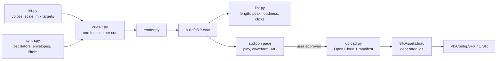

# Synthesized audio FX (Phase 10)

**Status 2026-11-28: 49 sounds are uploaded and wired into the game (§ Uploaded and wired). About half have never been heard by the user, and none has been judged in a real fight. Next: the user's listening playtest, re-renders from it, then the silent events (tier B).**

The user asked to replace the stand-in sound effects, and fill the silent events, with sounds built from scratch by synthesis so that the whole game sounds like one instrument. This supersedes the "buy a pack or use free sources" question in [[design/build-plan]] § Current focus item 4. Inventory of what plays today: [[systems/AudioSFX]] (stale in places, see § What the audit found).

## What the audit found (2026-11-23)

Read from the working tree, including the uncommitted bomb and boss-body work.

- **12 named ids, 6 distinct assets, 40 `VfxConfig.EFFECTS` entries.** Newer systems borrowed effect ids instead of getting their own sound. `wall_rise_rumble` alone now means Stone Wall rise, Stone Wall collapse, ward up and the boss countdown start. `impact_heal` means a heal, the boss eating a letter and a bomb defuse.
- **About 60 player-perceivable events are silent.** The ones that carry gameplay information: memorize success, every boss telegraph and body tell, the exposed and stunned windows, ward plates, hunger pull and eat, the bomb's fuse and correct tap, charge tier rings, round countdown / start / win / lose, damage taken, death, respawn, the collect stream.
- **No looping path exists.** `spawnEffect` is one-shot. Every sustained visual (charge orb, burn, shield bubble, fuse, tow tether, ward) is silent.
- **Probable live bugs** (inferred from the code, not yet heard):
  - Ground Slam's sound is parented to a shockwave ring that is destroyed after 0.5 s, while the sample runs about 4 s at its pitch.
  - A wrong bomb tap cues twice for the tapper (client fizzle plus the server's world cue).
  - A 20-shot volley plays about 40 positional Sounds plus one per hit.
- **Audio outside Rojo.** Dash and Roll sounds live only in the place file (`ReplicatedStorage.Shared.DashSounds`). A template `SoundService.Audio` tree (busses, three AudioPlayers) is in the place and nothing drives it.
- **Unused hooks ready for sound.** `DamageConfirm` fires at the attacker with no listener. `AttributeBarBuilder.setCapGlow` / `playGainSweep` / `playDrainRipple` have no callers.

## Platform constraints (researched 2026-11-23)

Sources are the official Roblox docs unless marked. To be moved to [[reference/open-cloud]] once stage 0 has verified them here.

| Fact | Consequence |
|---|---|
| No oscillator or noise generator exists in the engine. `AudioStreamWriter` writes samples but is Studio-only. | Sounds are rendered offline and uploaded. |
| Audio can't be updated in place. Every re-render is a new upload and a new asset id. | Iterate on local files; upload only approved finals; a manifest keyed by content hash stops repeat uploads. |
| Upload quota: one official page says 100 per month ID-verified (10 unverified), another says 2,000 per 30 days (100 unverified). Unresolved. | Plan for 100 until the user's Creator Dashboard shows the real figure. One file per cue, no round-robin variants in the first pass. |
| Sound-effect moderation can't be appealed. Forum reports (unconfirmed) of very short or near-silent files rejected or stuck pending. | A throwaway batch goes through first. Cues get a duration floor and a loudness floor. |
| The docs say an owner's audio always plays in their own games. An October 2025 forum bug shows permission prompts for own audio, and there is no known Open Cloud endpoint to grant a universe access. | Stage 0 tests upload-then-play in Studio and in a published build. |
| Accepted: mp3, ogg, wav, flac; up to 20 MB, 7 minutes, 48 kHz; mono or stereo. Roblox transcodes on import. | Write 16-bit mono WAV with `scipy.io.wavfile`, which is already installed. No new dependency. |
| Local audition inside Studio without uploading: only old forum routes (`rbxasset://` content folder), unverified. | Timbre is judged on a browser audition page. Volume, pitch and attenuation are Luau-side and tuned after upload at no quota cost. |

## Sonic direction (proposal)

The rule mirrors the level art rule in [[design/ArtDirection]] (native primitives, palette roles): **every cue is built by script from a fixed kit of voices, and no cue picks its own timbre.** That is what makes sixty sounds read as one game.

| Voice | Built from | Owns |
|---|---|---|
| **Letter** | sine plus two inharmonic partials, fast decay (a mallet) | block pops, buffer tiles, memorize, all UI |
| **Red** | saw and FM with grit, noise crackle, falling pitch | fire spells and burn |
| **Green** | soft sine and triangle bells, rising sweeps, warm thump | heals, Sanctuary |
| **Blue** | glassy inharmonic FM, high shimmer, filtered hiss | freeze, shield, stasis |
| **Stone** | band-passed noise through tuned resonators | Stone Wall, breakable walls, gates, slam debris |
| **Brain** | sub bass, detuned growl, wet resonant squelch | everything the boss does |
| **Gold** | the Letter voice plus an octave-and-fifth sparkle | wildcards, rewards, round win |

Rules that sit over the voices:

- **One key.** Every pitched cue takes its notes from one pentatonic scale, so overlapping cues are consonant.
- **Attacks don't sound like rewards** (user feedback 2026-11-25: Frost Nip "sounds more like a reward chime"). Reward cues (pops, memorize, heal, pickups) are in key, consonant, ringing, echoed. Attack cues take none of those: an out-of-key pitch with a clashing semitone, a noise transient on the front, falling motion, a short decay and no echo. Element colour comes from texture (ice crackle, fire roar), not from a pretty note.
- **Heard on a phone.** Phone and laptop speakers play little below about 150 Hz, and many players are on mobile. A deep cue keeps real energy between 150 and 400 Hz, which the ear reads as the low end. (The first round booms had 99% of their energy below 250 Hz.)
- **Texture without pitch.** Fire, wind and rumble are noise with slow, uneven movement. A steady pitch plus an even pulse reads as an engine: the first burn loop sounded "like a lawn mower" (user, 2026-11-25).
- **Friend or foe by harmony.** Player cues are consonant. Boss cues are detuned or use a tritone. A player can tell whose sound it was without looking.
- **Tiers add layers.** T1 is short, bright and dry. T2 adds body. T3 adds sub bass and a tail.
- **Every boss attack has a rising tell** whose length matches its windup, so the windup can be heard from cover.
- **Musical spelling (optional signature).** Each letter popped into the buffer plays the next step up the scale, and a successful memorize resolves to the chord. A longer word is a longer run.
- **Mix.** Mono, 48 kHz, 16-bit, peak at -1 dBFS, no leading silence, three loudness bands (UI, gameplay, boss).

## Cue scope

Counts are estimates until the cue sheet is written in stage 1.

| Tier | What | Cues |
|---|---|---|
| **A. Replace** | The 12 named ids, the events that borrow them given their own sound (bomb, spore, ward, entrance, hunger, arena pad), dash and roll | about 22 |
| **B. Gameplay-critical gaps** | Memorize success, boss telegraphs, exposed window, ward plate, hunger pull, bomb fuse tick and correct tap, charge tier ring, round countdown / start / win / lose, damage taken, death, respawn, mind full, collect stream arrival | about 18 |
| **C. Polish** | UI clicks, settings, portal panel, buffer reorder / select / destroy, kill feed, gate open, wall re-seal, spike pit, hit confirm | about 14 |
| **D. Loops** | Charge hum, burn, shield, fuse, tow tether, ward. Needs a new looping path in code. | 6 to 8 |

Recommended first pass: **A and B (about 40 uploads)**, then C, then D as a second pass.

## Pipeline

- **`tools/sfx/`** (Python, numpy and scipy only). Recipes are committed; renders go to a git-ignored `build/sfx/` and are reproducible from a fixed seed.
- **`lint.py`** fails a cue that is too short, too quiet, clipped, has DC offset or starts or ends on a click. This is also the guard against the moderation risks above.
- **`screen.py`** (added 2026-11-25): for a family of variants, measures each one against targets taken from the user's judgements and shortlists a few distinct ones. It narrows what the user listens to; it does not replace listening.
- **Audition page**: one static HTML file per render, grouped by voice, with play buttons, a waveform drawn in the browser, and A/B against the previous render. This is how the user approves timbre before any upload.
- **`upload.py`**: uploads only cues whose hash changed, polls the operation for the asset id and moderation state, writes `tools/sfx/manifest.json` (cue, hash, asset id, state), and has a dry run that prints the quota cost.
- **`src/shared/Audio/SfxAssets.luau`** is generated from the manifest. `VfxConfig.SFX` reads from it, so ids are never typed by hand.
- **Studio probe**: a client-side `PreloadAsync` sweep over the manifest (`IsLoaded`, `TimeLength > 0`), the pattern `VfxConfig` already documents.

## Game-side work

- Give each borrowed event its own `EFFECTS` entry and sound.
- One `UiSfx` client module owns non-positional cues. It replaces the four files that each build their own fizzle Sound.
- Client listeners for the silent events, on the attributes and remotes that already exist (listed in the audit).
- Fix the Ground Slam anchor, the double wrong-tap cue, and cap concurrent volley sounds.
- Bring the dash sounds under Rojo.
- Second pass: a looping path owned by the Vfx system.

## Team

At most three run at once ([sessions-and-subagents](../../docs/agents/sessions-and-subagents.md)).

| Role | Runs as | Owns | Must not touch |
|---|---|---|---|
| **Audio director** | the planning session | style guide, cue sheet, review of every cue, final mix | — |
| **Game designer** | one consult subagent in stage 1 | ranks the cue sheet by gameplay information; rules on friend-or-foe and musical spelling | code |
| **Tool programmer** | session | `tools/sfx/` except `cues/`, the audition page, upload, the generated Luau | `src/` apart from `SfxAssets.luau` |
| **Sound designer, players** | session, after the pilot | `cues/` for Letter, Red, Green, Blue, Gold | `kit.py`, `synth.py` |
| **Sound designer, boss and world** | session, after the pilot | `cues/` for Brain and Stone | `kit.py`, `synth.py` |
| **Gameplay programmer** | session | `VfxConfig` sound entries, `UiSfx`, new listeners, the fixes above | `tools/` |
| **QA and mix** | test-runner subagent plus a playtest | client-side verification that each cue plays, once, at the right place | — |

`kit.py` and `synth.py` change only through the director, so two sound designers can't pull the kit apart.

## Stages

| # | Stage | Who | Done when |
|---|---|---|---|
| 0 | **Spike the risks.** Render three test cues. Upload two (a 0.08 s blip, a 1.5 s sweep). Check moderation, playback in Studio and in a published build, and the real quota. Try the local-audition route. | director, user for the key and the quota figure | both ids play on a client, or the failure is understood. Costs 2 to 3 uploads. |
| 1 | **Style guide and cue sheet** in this page: every cue with its voice, length, loudness band, trigger and positional or not. | director, designer | the user signs off the list |
| 2 | **Toolchain.** | tool programmer | the pilot family renders, lints clean and shows on the audition page |
| 3 | **Pilot family**, about 8 cues: block pop, wildcard pop, buffer tile, memorize success, fizzle, one T1 cast per colour. **This locks the kit.** | director | the user approves by ear |
| 4 | **Pilot in the game.** Upload, generate ids, wire, playtest. | tool and gameplay programmers, QA | heard on a client in a real fight |
| 5 | **Production**, two lanes by family, a user audition per batch. | two sound designers, director | tier A and B approved |
| 6 | **Integrate** batch by batch, including the silent-event listeners and the fixes. | gameplay programmer, QA | no `VfxConfig.SFX` entry points at a stand-in |
| 7 | **Mix pass** in a playtest: volumes, attenuation, voice caps. | director, user | the user plays a full round |
| 8 | Tier C, then loops (tier D). [[systems/AudioSFX]] rewritten. | as above | — |

Stage 0 comes first because three of its answers (moderation of short blips, own-audio permission, the quota) can each change the plan.

## Decisions (user, 2026-11-23)

1. **Scope of the first pass: tiers A and B.** C follows, loops are a second pass.
2. **Sonic direction: not chosen yet.** The user wants to hear the clean mallet-and-synth kit and a retro chiptune kit side by side. The pilot family is rendered in both for a bake-off; the winner becomes the kit.
3. **Musical spelling: yes.**
4. **Timing: the spike, the tools and the pilot family start now**, alongside Phase 8.
5. **No uploads yet.** The tools are built and sounds are rendered and judged locally. The upload half of stage 0 waits for the user to provide Open Cloud access.

Still open: the real upload quota (not checked), and which kit wins the bake-off.

## Built so far (2026-11-23)

`tools/sfx/`: `kit.py` (key, mix targets), `synth.py` (primitives), `cues/sheet.py` (the pilot cue sheet), `cues/pilot_mallet.py` and `cues/pilot_chip.py` (the two kits), `render.py`, `lint.py`, `audition.py`. Three commands, in `tools/sfx/README.md`, produce `build/sfx/audition.html` (git-ignored): ten cues in each kit side by side, with A/B, a pick per cue and a "Copy feedback" button.

**Third kit, same day.** After hearing the first two, the user asked for a better block pop and for a 16-bit console FM character instead of 8-bit: synthetic, but close to the real sound. `cues/pilot_genesis.py` voices the pilot family with FM operators (`synth.op`, `synth.op_feedback`) and adds four pop experiments (bubble, cork, pickup chime, slap bass). Its own block pop is a bubble bursting onto a marimba note. The counts below are from before this kit; with it the render is 34 files, still with no lint failures.

**Fourth kit, 2026-11-25: a model of the chip.** The user named Phantasy Star IV and Shining Force II as the references. `tools/sfx/ym.py` models the console's sound hardware instead of imitating FM loosely: patches in register terms (algorithm, feedback, per-operator MUL / DT / TL / AR / D1R / SL / D2R / RR), the chip's own stepped envelope counter, rendering at the native ~53.3 kHz with no oversampling, 9-bit channel output, a first-order output low-pass, PSG squares and shift-register noise in 2 dB steps, 8-bit DAC samples held between writes, and a driver that changes pitch and level once per 60 Hz frame (echo is a note replayed later and quieter, as drivers did it). `cues/pilot_md.py` voices the pilot family with seven patches (blip, bar, bell, brass, flame, crystal, growl) and four more pop experiments (struck bar, bubble, pickup, crunch). The page now shows only the two 16-bit kits; the mallet and chiptune kits stay in the code for reference.

What the research could and could not source (2026-11-25):
- Sourced from plutiedev.com's YM2612 reference: the eight algorithms, register ranges, LFO rates (3.82 to 69.22 Hz) and depths. From Wikipedia: the 9-bit multiplexed DAC and the ladder effect (crossover distortion on the discrete chip in early consoles, reduced on the later ASIC).
- From memory of emulator sources, marked VERIFY in `ym.py`: the envelope rate tables, the feedback scale (0 to 4π), the modulation depth, the detune amounts and the ladder offset size. The output filter is first order by a forum claim; its 3.8 kHz cutoff is a by-ear choice.
- Not found: isolated sound-effect recordings of either game (the sound archives blocked automated fetches), which driver either game used, and the names in their sound tests. The credits are Izuho Takeuchi and Masaki Nakagaki (Phantasy Star IV) and Motoaki Takenouchi (Shining Force II).
- A bug the numbers caught: release rate is 4 × RR + 2 on the chip, not 2 × RR + 1. Before the fix, pops fell only 4 dB in 200 ms.

**Fire, 2026-11-25** (user: "test out a fireball explosion, and maybe a burning effect"). In the 16-bit RPG kit: three Fireball explosion takes (boom, crunch, rolling) built from a driven low-rate DAC blast, PSG noise whose clock steps down every frame, a low FM roar and debris crackle; a burn damage tick; and **the first loop**, a 2 s burning bed that crossfades its end into its start. The pipeline learned loops for it: a `"loop": true` cue keeps its exact edges in `render.py`, `lint.py` checks the wrap point instead of edge clicks, and a quieter `loop` band sits under one-shots. The game still has no way to play a loop; that is the tier D code work. Measured: the seam jumps 0.005 (about 3 times a typical sample step, -46 dB), and the loop holds within 2 dB across its length.

**Fire, second round, same day** (user: the explosion should be "more round and boomy"; the burn "sounds a little like a lawn mower"). Two round takes: a near-pure falling sine body with a soft attack, a swell of low-passed air through the DAC, a soft low rumble, and little drive. Take A falls 200 to 55 Hz and has 25% of its energy in 150 to 400 Hz; take B is deeper (5% there) and will be thin on phones. The bright boom stays as a comparison row. The burn was rebuilt with no tone: a band-passed noise roar and a PSG noise bed that both follow a slow random swell, clustered crackles of random size, and a 3 s loop. Its spectrum's largest peak is about 10 dB over the median, which is what plain noise does over that many bins. Demo rows are marked `"demo": true` and are exempt from the upload length cap.

**Fire, third round, same day** (user: "there is no distinct boom; it just starts and tapers off"). Measured, the round take was flat within 2 dB for its first 250 ms: no moment of impact, and the final saturation was lifting the tail toward the peak. The new takes lead with a kick drum through the DAC (pitch diving 260 to 60 Hz in 50 ms, saturated so phones hear its harmonics), with the round body entering 35 ms later and 10 dB under it, and the mix drive nearly off. Take A is the plain punch, B adds a short in-breath of rising air cut off by the hit, C adds a very short bright crack. The hit now stands about 9 dB above the level 100 to 200 ms later, against 1.8 dB before. The round take stays as a comparison row. Rule learned: **an impact needs a peak that stands well above its own tail**; check the 20 ms loudness steps, not only the overall shape.

**Screening, same day** (user: the punch takes sound "a little like a drum tom"; asked the director to review first and keep only promising ones). The director cannot listen, so review means measurement. `tools/sfx/metrics.py` turns the user's judgements into numbers, and `tools/sfx/screen.py` prints them for the takes the user already rated before ranking anything, so it is visible whether they agree with the ear:

| Take | User said | Punch (dB) | Pitch clarity | Centroid (Hz) |
|---|---|---|---|---|
| bright boom | not round | 1.0 | 0.64 | 449 |
| round take | no boom, just tapers | 1.8 | 0.79 | 118 |
| punch A | a little like a drum tom | 9.1 | 0.69 | 93 |
| burn loop (noise, control) | — | 2.3 | 0.18 | 1169 |

Punch separates "no boom" from the punch takes. Pitch clarity showed every boom so far rested on a tuned note, so a hit on top read as a drum. The explosion was rebuilt as a family (`pilot_md.explosion`, twelve parameters) led by a burst of muffled noise. 800 variants were screened against targets that each cite the judgement they stand for (punch at least 9 dB, clarity at most 0.45, centroid 120 to 380 Hz, at least 20% of energy in 150 Hz to 2 kHz for phones, ring 0.45 to 1.1 s). 28 passed. Ties went to clear margins, and the three picks had to differ from each other. They measure punch 10 to 15 dB, clarity 0.24 to 0.29, centroid 222 to 350 Hz. `cues/shortlist_fireball.json` holds them and is committed, so the shortlist is reproducible. The clarity limit of 0.45 is a judgement and has not been confirmed by ear. The punchy picks also sit about 6 dB under the other spells in average level, because their peak sets the normalisation.

**Big fireball, same day** (user: shortlist #1 "sounds closer", "doesn't sound as big", "phonetically tch-ba-boom"). Read as three events: a bright spark, the hit, then a second, bigger boom that swells in and rolls on. The hit is #1 exactly (`BA_PARAMS`), since that is what the user liked; the spark and boom are the new family (`pilot_md.big_explosion`, `BIG_SPACE`). `metrics.structure` measures the spark's brightness, whether hit and boom are two events joined by a dip, the boom's size, and the level 0.3 to 0.8 s in. On #1 it reads "not big": no spark (260 Hz), boom 11.5 dB under the hit, -30 dB at 0.3 to 0.8 s, gone by 0.56 s. Two corrections while screening: the first picks had a 13 to 20 dB dip, near silence, which would sound like two sounds, so the dip is capped at 10 dB; and the default tie-break (punch, measured where the boom now is) chose the smallest booms, so this family breaks ties toward the bigger boom. The three picks: spark 4.4 to 4.8 kHz, dip 7.5 to 9.8 dB, boom within 2 dB of the hit, -5 to -6.5 dB at 0.3 to 0.8 s, ring about 1.6 s, pitch clarity about 0.3. They also land at the other spells' average level, which #1 did not.

**Chosen, 2026-11-25:** the user picked big fireball #3 ("soft spark, swelling boom") as the Fireball explosion for now, to test in the game. Its settings are locked in `pilot_md.FIREBALL_EXPLOSION_PARAMS`. The session's lessons were written up as the agent guide [docs/agents/audio-sfx.md](../../docs/agents/audio-sfx.md), linked from `CLAUDE.md`, so later sound sessions load them only when they need them.

**Chosen for upload, 2026-11-25:** Fireball explosion (big #3), Frost Nip cast (take B, blast; the user accepted take B or take A, and B's rush suits a cast) and Burning (take B, roaring loop; it cannot be wired until the game can play loops). They are listed in `tools/sfx/chosen.json`. `package.py` copies them to `build/sfx/upload/` as `BF_<What>.wav` with an `UPLOAD.md` checklist, and records each file's sha256 the first time. A later render that differs is refused, because the code that makes it has changed since the user approved it. Tested: a one-sample change is refused.

**Letter lab, same day** (user: the pops and letter sounds should be "something a little more complex than just generic sound effects"). Three experiments, one idea each, in `cues/letter_lab.py`: (1) colour instruments, where the block's colour picks the instrument (red brass, green wood, blue glass, wild gold); (2) word melodies, where each letter has a fixed note, so a word has a tune that memorizing plays back, and J/Q/X/Z shimmer; (3) singing letters, where FM formant synthesis sings each letter's phonics sound. Upload cost shaped the ideas: pitch can be set in game with `PlaybackSpeed`, so 1 and 2 need about one file per instrument and 3 about one per letter. A bug caught by measurement before the user heard it: with one harmonic per formant, 'a' and 'e', and 'o' and 'u', were identical at the sung pitch. Each formant now sits on the two nearest harmonics, weighted, using eight operators on two channels. The closest pair of vowels now differs by 6.6 dB per harmonic.

**Collect lab, same day** (user: design sounds for popping a block and the mana being drawn in, from the visuals). Source: [[design/tap-to-pop]] § The pop and § Collect stream, `collectStream.luau`, and a playtest in which the effect code was called beside the character (the player starts in the lobby, where no block can be popped). Three moments with their own triggers: the pop on the tap, a 0.4 s draw-in that starts on the server's confirmation (one round trip later online) with 3-8 sparks landing between 0.26 and 0.4 s, and the arrival, whose flash the design calls for but was never built. `cues/collect_lab.py` has three takes on that structure: A vacuum (air sucked in, rising in pitch), B comet (a tuned glide up an octave, landing on a chord), C spin-in (a whirl that turns faster as it closes in, landing on a gulp). Each has a fast-speller demo (four letters 0.3 s apart). Measured fix before the user heard it: lab 1's bell pop rang for about 350 ms and buried the draw-in, so the collect pop fades by TL steps per frame within about 0.1 s; the draw-in then rises from about -37 dB to the landing at -20 dB.

**Naming, 2026-11-28.** The upload files first carried a `_v1` suffix, so a re-render would show as a second asset beside the first. The user, a programmer, called it a bad convention: the version belongs in the record, not the name. Dropped. The game refers to sounds by asset id; `chosen.json` holds the current id and the approved fingerprint, and git holds the history.

**Take C chosen; styled toward the spells, same day.** The user preferred take C (spin-in) and worried its style would clash with the realistic spell and explosion sounds. Measured by pitch clarity: the chosen spells sit at 0.16 to 0.46, take C's whirl at 0.16, but its pop at 0.88 and its landing at 0.90, both pure chip notes. The director recommended a hybrid: physical ends (the block cracking apart, with colour carried by the crack's band; a rush of air with a muffled thump on landing) and a quiet note 12 dB under them, which keeps colour and musical spelling. Both were built (`collect_lab.stream_spin_real`, `TAG_DB`). The fully physical version measures 0.41, inside the spells' range; the hybrid measures 0.63, between the two. The hybrid's note level is the dial between them. The design principle this tests is that world sounds stay physical and only the player's own progress carries a tonal layer.

**Collect chosen and the theme written, same day.** The user chose take C's fully physical version ("the hybrid sounds too busy especially when fast spelling"). For upload it is split into the files the game plays at different moments: four cracks on the tap (`BF_Collect_Crack_<Colour>`) and one stream on the server's confirmation (`BF_Collect_Stream`, landing baked in at 0.4 s). The split layers rebuild the approved sequence sample for sample. The red, green and gold cracks use the blue row's fragment pattern, so they differ slightly in fragments from the fast-speller demo. At the user's request the rules were written up as a sound theme, [[design/AudioDirection]], which the agent guide now loads first.

**Production lanes, 2026-11-28** (user: "do the sounds for all the placeholder sound effects already in the game", with sessions in appropriate roles). Scope is tier A: every live stand-in (the twelve `VfxConfig.SFX` ids across their effect entries), the effects other systems borrow (arena pad, boss ward and entrance, hunger, scramble puzzle), and the place-file dash and roll. Silent events (tier B) wait. Three audio-designer sessions, one lane each, each owning only `tools/sfx/cues/lane_<name>.py` and rendering into `build/sfx/lanes/<name>/` (`render.py --lane`), so nothing collides:
- **fire** (12 cues): red casts T1 to T3, Firebolt and Fireball flight, the generic damage hit, the Inferno eruption, the fizzle, dash, roll, and the arena teleporter.
- **nature** (15): blue and green casts, freeze, shield form / block / break, heal, buff, and the stone shared by Stone Wall and breakable walls.
- **boss** (13): volley launch, projectile death, Ground Slam, knockup, entrance, ward, hunger and the scramble puzzle.

The director wrote each cue's brief in its lane file. No programmer session yet: wiring needs the asset ids, which come after the upload. No separate designer: the theme and the briefs carry the design calls, and open rulings go to the user. The sessions do not commit, upload or edit the wiki; they report each chosen take (`CHOSEN` in the lane file), and the director packages it (`chosen.json` entries carry a `lane`).

**Lanes finished and reviewed, 2026-11-28.** All three lanes have a take for every cue: fire 12, nature 15 (plus a shield hum loop the lane added; the buff is deferred at the user's request), boss 14 (including a new cue, the boss rising before its slam). Of these 41, the user picked 23 by ear (fire 12, nature 5, boss 6); the rest were picked by a lane or the director after the user said "make your best recommendation, i want to hear the sounds in game first" and "make your best take decision for any questions", and nobody has heard them. `chosen.json` marks each.

The user then asked the director for a review pass over the whole upload set. Measured on one scale:
- **Levels.** The eight earlier sounds peaked 5.5 dB under the lanes' (the pilot kit's `trimDb`). `package.py` gained `gainDb`, a level-only change applied to the copy, so the approved render and its fingerprint are untouched.
- **Seven unheard nature picks sent back.** The shield family was a pure tone near 190 Hz (clarity 1.00) and the shield cast was the loudest sound in the set; the heal and Mend were carried by in-key tinkles (0.95, 0.65); the heal peaked at 0.9 s and Stasis at 0.7 s though both effects land at once. Revised: clarity 0.16 to 0.31, hits within 0.12 s.
- **Boss picks.** Eight decided by the director by measurement: decay speed for the 20-shot volley, phone-band energy for the projectile death, the voice on the slam's tell but not its impact.
- **Kept over the line:** user picks (explosion 0.46, shield block 0.50, ward up 0.56) and the bass rumbles of the boss entrance (0.52), where low noise measures as pitch.

The set is 49 files, none under the phone floor. Process lessons: a session's reported edit list over-reports (it named `pilot_md.py`, `lint.py` and a dictionary file that never changed; `git diff` is the check); packaging linted a loop as a one-shot until fixed; a lane left to choose alone drifts toward tonal sounds.

### Uploaded and wired, 2026-11-28

The user imported all 49 files in Studio by hand in one bulk import. The ids did not need pasting back: the Studio MCP's Open Cloud call `GET /cloud/v2/users/<userId>/inventory-items?filter=inventoryItemAssetTypes=AUDIO` lists them, and `MarketplaceService:GetProductInfo` gives each name. One name came back as `##########` (Roblox's text filter on "Knockup"); it was matched by being the only file left and by its length. Every asset loaded in Studio with the same length as its local file. Ids are in `chosen.json` and `VfxConfig.SFX`.

Wiring is described on [[systems/AudioSFX]]. In short: one `VfxConfig.SFX` entry per file; own effect entries for the eleven boss, scramble and teleporter events that borrowed another effect; dash, roll and the collect stream as sound-only effects; a looping path (`Vfx/LoopSound`) for burning and the shield hum; the slam warning triggered by the client's Telegraph so that it ends on the landing; the slam sound moved off the ring that was cutting it at 0.5 s (the suspected cut-off was real); pitch ranges reduced to a slight spread or removed; a client preloader, because a first play started about 0.4 s late.

Checked on one Studio client: everything loads, and each new path plays. **Not checked: how it sounds in a fight.** Open after wiring:
- The scramble tap plays at one pitch. Climbing per letter needs a pitch on `VfxBroadcast.playAt`.
- The 4 s entrance rumble starts an 8 s countdown, so it ends 4 s before the landing. Either delay it or render an 8 s one.
- Volley (parked) borrows Firebolt's sounds. The buff sound is still the old latch.
- Volumes are first guesses by role. Expect a balance pass after the listening playtest.

Checked: 20 files render and lint with no failures; the page loads with all 20 waveforms drawn and no script errors. **Not checked: how any of it sounds.** No person has listened yet, and the recipes are a first pass written without hearing them. The chiptune kit is trimmed 5 dB so the two sit at about the same loudness.
